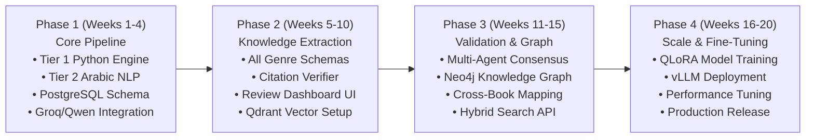

# System Architecture & Technical Specification
## AI-Powered Islamic Digital Library — Knowledge Enrichment System

---

## 1. System Overview & Architectural Philosophy

The objective is to process digitized Islamic books in Arabic and automatically enrich them with structured metadata, deep structural indexes, bidirectional annotation maps, knowledge units, and entity graphs—all maintained in a separate, stand-off enrichment layer that leaves original content 100% untouched.

The system uses a **Tiered Hybrid Neuro-Symbolic Architecture** that routes each processing step to the most deterministic and cost-effective component:

```
Task Complexity ────────────────────────────────────────────────────────►
[Tier 1: Deterministic Python] ► [Tier 2: Arabic NLP] ► [Tier 3: Single-Pass LLM] ► [Tier 4: Multi-Agent]
          FREE                         FREE / Local             ~$0.30/M Tokens           Selective (<10%)
     0% Hallucination                0% Hallucination              Near-Zero                 Validated
```

---

## 2. System Architecture Diagram

```mermaid
flowchart TD
    INPUT["📥 Digitized Book\nJSON + PDF + pub_id"]

    subgraph T1["TIER 1 — Conventional Python Engine (Free)"]
        T1A["Schema & SHA256 Validator"]
        T1B["Block Indexer\nb000001 → b000594"]
        T1C["Footnote Stitcher\n(multi-page continues=true)"]
        T1D["Ref Mapper\n(refs[] arrays → bidirectional links)"]
        T1E["TOC Extractor\n(heading/toc_heading blocks)"]
        T1F["Quality Gates\n(orphan refs, empty blocks, page counts)"]
    end

    subgraph T2["TIER 2 — Arabic Classical NLP (Free / Local)"]
        T2A["Arabic Normalizer\n(PyArabic: diacritics, hamza, alef)"]
        T2B["Morphological Analyzer\n(CAMeL Tools: root, lemma, POS)"]
        T2C["Rule-Based Pattern Matcher\n(Hadith transmission verbs, classical titles)"]
        T2D["Search Token Builder\n(normalized tokens → search index)"]
    end

    subgraph T3["TIER 3 — Single-Pass Grounded LLM (Groq / Qwen 27B)"]
        T3A["Metadata Extractor\n(grounded, citation-required)"]
        T3B["Genre Classifier\n(few-shot, constrained output)"]
        T3C["Knowledge Unit Extractor\n(genre-specific Pydantic schemas)"]
        T3D["Programmatic Citation Verifier\n(substring check in source text)"]
    end

    subgraph T4["TIER 4 — Multi-Agent Consensus (Selective)"]
        T4A["Cross-Book Relationship Agent\n(Sharh / Hashiyah detection)"]
        T4B["Scholarly Disagreement Resolver\n(Ikhtilaf analysis)"]
        T4C["Multi-Model Consensus Judge\n(confidence < 0.85 → re-verify)"]
        T4D["Human Review Router\n(confidence < 0.70 / Fiqh rulings)"]
    end

    subgraph STORAGE["Knowledge Infrastructure"]
        DB1["PostgreSQL\n(books, metadata, enrichment units)"]
        DB2["Qdrant\n(semantic vector index)"]
        DB3["Elasticsearch / Meilisearch\n(Arabic full-text search)"]
        DB4["Neo4j\n(scholarly knowledge graph)"]
    end

    INPUT --> T1
    T1 --> T2
    T2 --> T3
    T3 -->|"confidence ≥ 0.85"| STORAGE
    T3 -->|"confidence 0.70–0.84"| T4
    T4 -->|"validated"| STORAGE
    T4 -->|"confidence < 0.70"| HITL["👤 Human Review\nDashboard"]
    HITL -->|"approved"| STORAGE
```



---

## 3. Tier Responsibilities & Task Allocation

### Tier 1 — Conventional Python (Deterministic & Free)
Handles all tasks where explicit structural data exists in the input:
- **Integrity Validation:** SHA-256 hash checks and schema version validation.
- **Block Indexing:** Normalizes and indexes all content blocks (`b000001` → `b000594`).
- **Footnote Mapping:** Bi-directional resolution of inline reference ranges to footnote blocks using pre-existing `refs[]` data.
- **Footnote Stitching:** Joins footnotes that cross page boundaries (`continues: true`).
- **Table of Contents:** Hierarchical heading tree extracted directly from `heading` and `toc_heading` block types.
- **Quality Auditing:** Identifies orphaned reference tags, missing text blocks, or page count mismatches.

### Tier 2 — Classical Arabic NLP (Local & Deterministic)
Handles linguistic preprocessing without making remote API calls:
- **Text Normalization:** Stripping diacritics (*tashkeel*) and unifying orthographic variants of *alef* and *hamza* via `PyArabic`.
- **Morphological Analysis:** Root and lemma extraction using `CAMeL Tools` for Arabic search indexing.
- **Transmission Verb Scanning:** Pattern-based detection of Hadith transmission chains (`حدثنا`, `أخبرنا`, `ثنا`, `روى`, `سمعت`).
- **Gazetteer Reference Matching:** Matching citations against canonical classical Islamic texts (*Sahih al-Bukhari, Al-Isabah, Al-Siyar, Al-Tabaqat al-Kubra*).

### Tier 3 — Structured Single-Pass LLM (Semantic Extraction)
Invoked only on focused context windows where semantic interpretation is required:
- **Bibliographic Metadata:** Distinguishing original author from modern editor (*muhaqqiq*), identifying death years, and publisher details.
- **Genre Classification:** Classifying works into Fiqh, Hadith, Tafseer, Seerah, Aqeedah, Biographies, or History.
- **Knowledge Unit Extraction:** Parsing specific domain units (biographical profiles, Hadith narrator chains, Tafseer verse explanations) into typed JSON schemas.
- **Anti-Hallucination Triple-Lock:**
  1. *Source Grounding:* Model receives actual source text and is restricted from external parametric memory.
  2. *Mandatory Citation:* Every extracted field requires a companion `source_quote` matching source text verbatim.
  3. *Null Policy:* If information is absent from context, the field returns `null` rather than inferring.
  4. *Programmatic Check:* Immediate substring verification checking that claimed quotes exist in source blocks.

### Tier 4 — Multi-Agent Consensus & Human-in-the-Loop (Selective)
Invoked for complex reasoning across documents:
- **Cross-Book Linkage:** Identifying commentary (*Sharh*), supercommentary (*Hashiyah*), or abridgment (*Mukhtasar*) relationships.
- **Consensus & Arbitration:** Resolving model disagreements when initial extraction confidence falls below 0.85.
- **Human Review Gate:** Automatic routing of legal rulings (*Fiqh*) or creed propositions (*Aqeedah*) to a scholar review queue before public publishing.

---

## 4. End-to-End 12-Step Data Flow

```mermaid
flowchart LR
    S1["1. Receive Book\nJSON + PDF"] --> S2["2. Tier 1\nValidate SHA256\n& Index Blocks"]
    S2 --> S3["3. Tier 1\nExtract Raw Meta\nfrom Identifiers"]
    S3 --> S4["4. Tier 2+3\nClassify Genre\n& Family Works"]
    S4 --> S5["5. Tier 1+2\nBuild TOC &\nSearch Tokens"]
    S5 --> S6["6. Tier 1\nMap Footnotes\n& Anchors"]
    S6 --> S7["7. Tier 3\nExtract Knowledge\nUnits (Genre Schema)"]
    S7 --> S8["8. Tier 3\nEntity Extraction\n& Disambiguation"]
    S8 --> S9["9. Tier 3\nVerify Citations\nProgrammatically"]
    S9 --> S10{"10. Confidence\n≥ 0.85?"}
    S10 -->|Yes| S11["11. Store in\nEnrichment Layer\n(Postgres + Qdrant)"]
    S10 -->|No| S10b["Tier 4 / Human\nReview Queue"]
    S10b -->|Approved| S11
    S11 --> S12["12. Publishing API\n& Discovery Search"]
```



---

## 5. Technology Stack & Knowledge Infrastructure

| Component | Selected Technology | Purpose |
|---|---|---|
| **Tier 1 Engine** | Python 3.11+ / Pydantic | Fast, deterministic block parsing, footnote stitching, and TOC |
| **Tier 2 NLP** | PyArabic, CAMeL Tools | Diacritic normalization, root/lemma analysis, gazetteer scanning |
| **Tier 3 LLM** | Groq API (`qwen/qwen3.8-27b`) | High-speed, cost-effective inference for grounded extraction |
| **Schema Validation** | Instructor + Pydantic v2 | Guarantees strict JSON schema adherence and retry loops |
| **Relational Database** | PostgreSQL 16 | Primary store for book metadata, block indexes, and enrichment units |
| **Vector Database** | Qdrant | Dense vector search for semantic retrieval across knowledge units |
| **Search Engine** | Elasticsearch / Meilisearch | Morphological full-text search supporting Arabic roots and lemmas |
| **Graph Database** | Neo4j *(Phase 2)* | Modeling cross-book family relations, teacher-student chains, and citations |
| **Review UI** | Next.js + Tailwind CSS | Side-by-side verification interface for exception-based human review |

---

## 6. Genre-Specific Knowledge Schemas

### A. Biographical & Genealogical Literature (*Tarajim / Nasab*)
```python
class BiographyEntry(BaseModel):
    block_id: str                      # Anchored source block ID (e.g. b000105)
    name: str                          # Full name in Arabic
    source_quote: str                  # Verbatim quote from source text
    relation_type: Optional[str]       # Companion, family, narrator, scholar
    summary: Optional[str]             # Concise biographical summary
    referenced_books: list[str]        # Classical books cited in footnotes
    footnote_block_ids: list[str]      # Linked footnote block IDs
    confidence: float = Field(ge=0.0, le=1.0)
```

### B. Tafseer Literature (Quranic Exegesis)
```python
class TafseerUnit(BaseModel):
    ayah_text: str                     # Sacred verse in Arabic
    explanation_summary: str           # Synthesized meaning of the exegesis
    source_quote: str                  # Exact quote from commentary text
    scholarly_opinions: list[str]      # Mentioned opinions (Ibn Abbas, Mujahid, etc.)
    confidence: float = Field(ge=0.0, le=1.0)
```

### C. Hadith Literature
```python
class HadithUnit(BaseModel):
    block_id: str
    hadith_text: str                   # Matn (narration text)
    narrator_chain: list[str]          # Isnad list in chronological order
    transmission_verbs: list[str]      # Haddathana, Akhbarana, etc.
    grading: Optional[str]             # Sahih, Hasan, Da'if if present in text
    grading_source: Optional[str]      # Scholar who graded the Hadith
    source_quote: str
    confidence: float = Field(ge=0.0, le=1.0)
```

---

## 7. Human-in-the-Loop Review Architecture

To ensure scholarly accuracy without manual reading of every page:

1. **Exception-Based Routing:**
   - Extractions with 100% verified citations and confidence ≥ 0.85 pass automatically to the enrichment store.
   - Any citation mismatch, low confidence (< 0.85), or sensitive religious ruling (*Fiqh / Aqeedah*) is routed to the scholar review queue.
2. **Review Interface Design:**
   - Displays original digitized Arabic text blocks on the left and extracted JSON fields on the right.
   - Highlights the exact `source_quote` substring within the source text.
   - Allows scholars to approve, edit inline, or reject with a single click.
3. **Continuous Learning Loop:**
   - Every human modification is recorded as a `(prediction, correction)` pair.
   - Approved corrections serve as the golden dataset for supervised fine-tuning (LoRA) of open-weight models in Phase 2.

---

## 8. Implementation Roadmap


